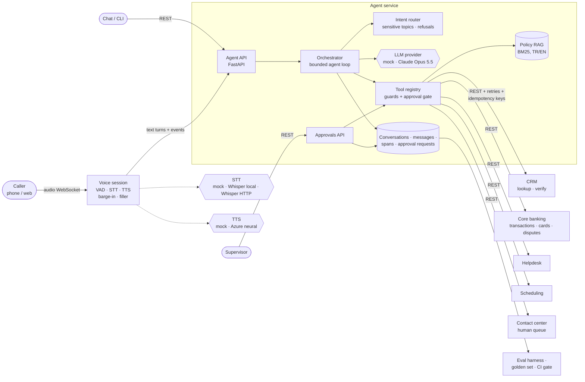
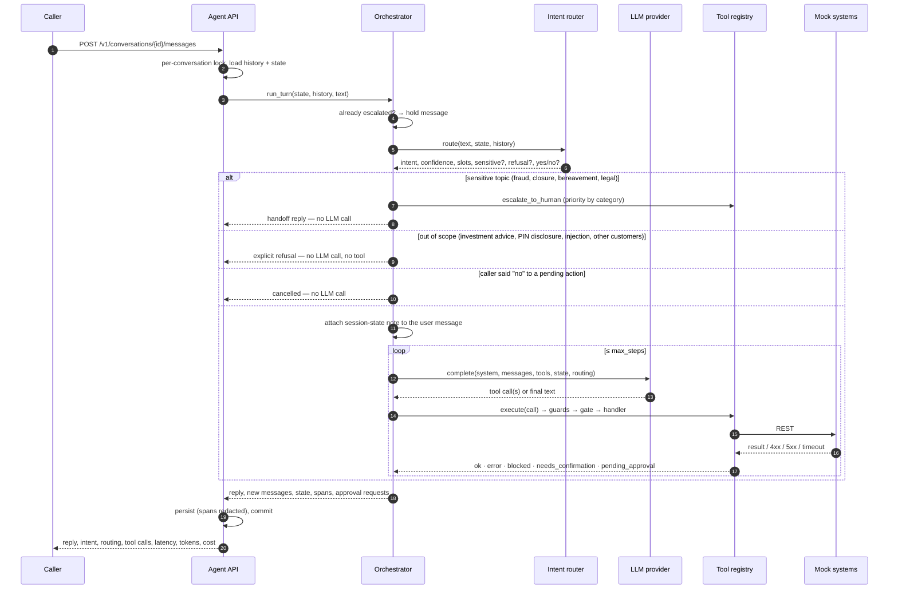
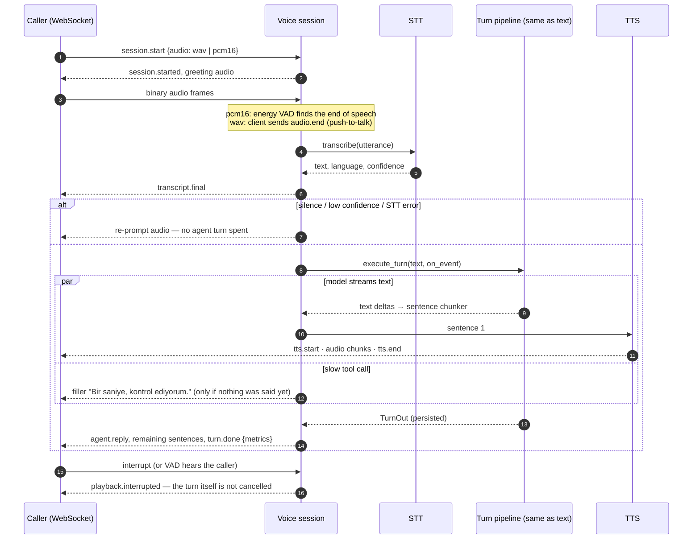
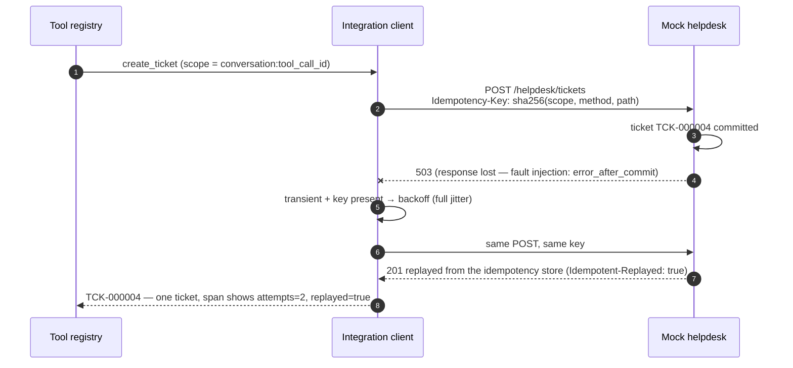
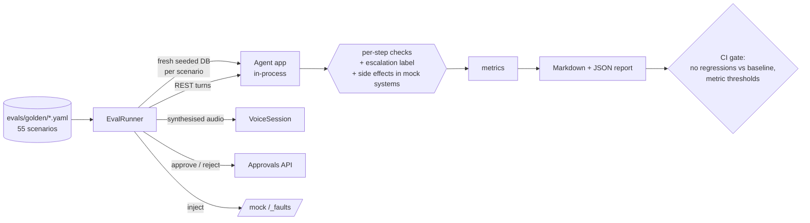
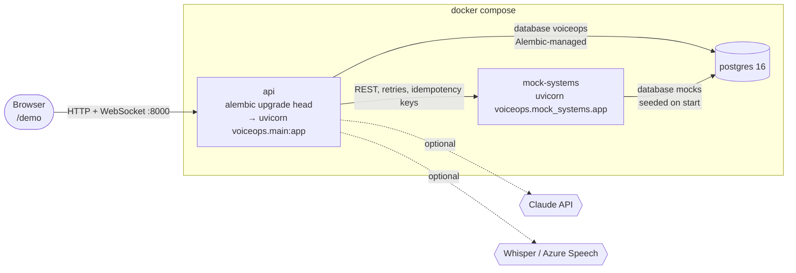
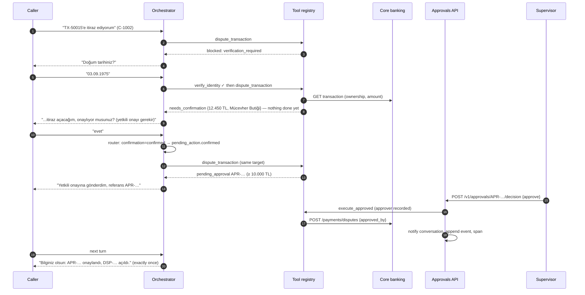

# Architecture

## Context

A fictional Turkish digital bank (**VoiceOps Demo Bank**) wants a first-line
voice/chat agent for its contact center. Callers speak Turkish or English. The
agent must resolve routine requests (payment status, tickets, callbacks, policy
questions), carry out a few sensitive actions safely (block a card, dispute a
charge), and hand anything risky or unresolved to a human with full context.

## Component view

## One turn

## Voice turn (M3)

The voice channel reuses the exact text pipeline (`api/turns.py`): same router,
guards, approval gate, tools, persistence and traces. It adds:

* **Sentence pipelining.** The orchestrator emits everything the caller should
  hear as ordered events (`text` deltas, `text_break`, `tool`). Claude is streamed
  when a listener is attached, so TTS starts on the first sentence while the model
  is still writing. The concatenated events equal the persisted reply.
* **Latency masking.** If nothing has been said `VOICE_FILLER_AFTER_MS` after the
  caller stopped talking (typically a slow backend), a short filler is spoken.
* **Barge-in.** `interrupt` (client VAD) or speech detected by the server VAD
  stops playback. The turn completes and is persisted; the assistant message
  records `voice.heard`, `voice.cut_off` and `voice.interrupted`, so the
  transcript reflects what the caller actually heard.
* **Speech text shaping.** Citations are dropped from the audio (kept in the
  transcript and response), and reference numbers are spelled out (`A P R, C 1 E D…`).
* **Metrics per turn.** `stt_ms`, `agent_ms`, `first_audio_ms` (end of caller
  speech → first audio byte), `first_reply_audio_ms`, `tts_ms`, `total_ms`; also
  stored on the message and as `stt` / `tts` spans for M4.

## Resilience: timeouts, retries, idempotency (M3)

* Per-attempt timeout (`INTEGRATION_TIMEOUT_S`) **and** a total deadline per call
  (`INTEGRATION_DEADLINE_S`): a voice caller is waiting, so a slow system fails
  fast into a fallback (callback, ticket, human) instead of stacking retries.
* Retried: timeouts, connection errors, 429 and 5xx; only for reads and for
  POSTs, which always carry an `Idempotency-Key`. Not retried: other 4xx.
  `Retry-After` is honoured unless it exceeds the budget.
* Keys are deterministic per tool call, so executing the same tool call twice is
  also safe; supervisor-approved actions use the approval id as the scope.
* The agent API accepts `Idempotency-Key` on `POST /messages` too, so a client
  retry after a network blip replays the stored reply instead of running the
  turn (and its side effects) again.
* Speech providers retry before the first byte only (re-playing half a sentence
  is worse than falling back to text); Claude uses the SDK's retries.
* The mock systems expose `/_faults` (error, error-after-commit, delay, 429 with
  `Retry-After`) so all of this is demonstrable with curl and covered by tests.

## Evaluation (M4)

* **Scenarios are data.** YAML with a strict schema (unknown keys are errors, so a
  typo cannot silently disable a check). Each step can label the intent, the exact
  tool sequence and statuses, required / forbidden reply text, state (verified,
  awaiting confirmation, language), escalation, and for voice re-prompts and filler.
  Conversations can include supervisor decisions and injected faults.
* **Black-box, reproducible runs.** Every scenario gets a freshly seeded database
  and goes through the public APIs, so the eval measures what a client sees, and
  side effects (a blocked card, a ticket) are verified in the mock systems.
* **Metrics with definitions in the report**: scenario pass rate and pass^k over
  repeats, intent accuracy and per-intent recall, tool selection accuracy,
  tool-call success, escalation confusion matrix, turn latency and voice time to
  first audio (clean and fault-injected reported separately, so a deliberate 3 s
  timeout doesn't masquerade as a slow agent), cost per conversation.
* **Failure-mode report**: failed checks grouped by category with expected vs.
  actual, known limits (strict: a passing known limit fails the build), and which
  failure modes the set exercises.
* **Baseline diff**: `--baseline` lists regressed / fixed scenarios and metric
  deltas; `--save-baseline` accepts a run. `tests/test_evals.py` runs the whole set
  on the mock baseline as part of `pytest`.
* **Honesty rules**: the paraphrase slice was written before the first run and is
  not tuned against; mock latencies and costs are labelled as such in the report;
  Claude numbers are only shown from a real `--provider anthropic` run.

## Deployment (M5)

* **One image, two roles.** The same image serves the agent API and the mock
  systems (different command); non-root user, health checks on `/health`.
* **Separate databases, like separate vendors.** The agent never sees mock-system
  tables. The agent's schema is versioned with Alembic (`migrations/`); a test
  checks that migrations and models agree. The mock systems are disposable and
  recreated from the seed.
* **Per-conversation serialisation across replicas** with a transaction-scoped
  Postgres advisory lock (plus the in-process lock). Released at commit or
  rollback, so a crashed replica can't hold it. This replaced the Redis lock in the
  original plan: one fewer moving part to run at a customer site.
* **Secrets only from the environment.** Compose refuses to start without
  `POSTGRES_PASSWORD`; empty optional keys are treated as unset; the supervisor
  endpoints take `X-API-Key` when `SUPERVISOR_API_KEY` is set.
* **Local single-process mode** (SQLite, mock systems mounted under `/mock`)
  stays the default for development, tests and evals.
* **Verified end to end** on Docker 29.5 with Postgres 16: a fresh-volume start
  (migration, separate databases, seeded mocks), the curl walkthrough, a voice call
  over the WebSocket, supervisor-key enforcement (401 without, 200 with), the web
  demo, the full test suite against Postgres, and 12 concurrent turns on one
  conversation through two API replicas, serialised with no duplicate turn or
  sequence numbers (`examples/replica-race.py`).

## Sensitive actions: verification → confirmation → (supervisor)

The approval gate lives in the tool registry, so it is identical for the mock and
for Claude. The caller's "yes" is detected by the router on the caller's *own next
turn*; a model cannot confirm on the caller's behalf, and the confirmation binds
to one target (card id / transaction id). The core banking mock also refuses
large disputes without an approver: defence in depth.

## Key decisions

| Decision | Why | Trade-off |
|---|---|---|
| Guards and approval gate in the tool registry, not the prompt | Prompt rules are advisory; code is enforced. A confused or injected model still can't act for an unverified caller or skip confirmation. | Some duplication between prompt and code. |
| Customer id from session state, not tool arguments | Prevents the model (or a prompt injection) from acting on another customer. | No "look up someone else" flows (none needed). |
| Router before the LLM | Every turn gets an intent label for evals; sensitive topics, refusals and yes/no handling never depend on a model; mandatory handoffs and refusals cost zero tokens. | Keyword router has known limits (tracked as xfails); M4 compares it with LLM routing. |
| Agent reaches systems only over REST | Mirrors a customer deployment; timeouts, 4xx/5xx and schema drift show up as they would on site. | A few ms per hop locally. |
| BM25 with Turkish 4-char stems, no cross-language fallback, query-coverage gate | Small, keyword-heavy corpus; deterministic and explainable; no embedding service to run. Cross-language fallback produced confident wrong answers ("interest" ~ "internet"), so it was removed. The golden eval caught a single shared word ("ücret") pulling in the wrong section, so a passage must also cover half of the question's content words. | Lower recall on paraphrases than embeddings; interface allows swapping in hybrid retrieval. |
| Postgres advisory locks instead of Redis for per-conversation serialisation | Correct across API replicas, released automatically with the transaction, no extra service to operate. | Holds one connection per active turn; fine for contact-center concurrency, revisit at very high scale. |
| Alembic for the agent schema only; mock systems recreated from seed | The agent's data is the system of record and needs versioned migrations; the mocks stand in for external systems. | Two table-creation paths (Alembic in Docker, `create_all` in dev and tests), kept in sync by a test. |
| Golden eval as black-box conversations with a strict schema | Measures what a client sees (including side effects) and works unchanged for any LLM provider; a typo in an expectation is an error, not a silently skipped check. | Scenarios take effort to write; the keyword router's paraphrase gaps show up as failures (intended). |
| Session state as a mid-conversation `system` message with `clear_at: next_user_message` | Operator channel the caller can't spoof; shown once per turn but stored unchanged, so history stays append-only (prompt cache + thinking-block replay stay valid). | Claude-specific beta; mock ignores it. |
| Raw Claude content blocks stored and replayed verbatim | Thinking and fallback blocks must be passed back unchanged. | Transcript rows are larger. |
| Claude Opus 5.5, effort `low`, server-side refusal fallbacks on | Routine, latency-sensitive voice turns; effort is the first lever to raise if evals show headroom. | Needs measurement in M4 before tuning. |
| Clean state machine instead of LangGraph | Small graph (route → identify → verify → act → confirm → respond / escalate), easy to trace and test. | Re-evaluate if flows become multi-agent. |
| Redact on the way out (spans, logs), keep the transcript | Transcripts are the system of record; dashboards and log pipelines never see phone numbers, birth dates or national ids. | Transcript storage needs its own access control. |
| Never store caller audio | A voice is biometric personal data under KVKK/GDPR; transcripts are enough for QA and evals. | No audio replay for disputes about what was said. |
| Barge-in stops audio, never the turn | A tool may already have changed a system of record; cancelling mid-turn would leave the transcript out of sync with reality. | The agent may finish an action the caller talked over; the confirmation gate keeps that to non-destructive steps. |
| Sentence-level TTS pipelining + filler | Cuts time-to-first-audio without a streaming-TTS dependency; filler covers slow backends. | Prosody across sentence boundaries is slightly less natural. |
| Retries only with idempotency keys, bounded by a deadline | Retrying a POST without a key is how duplicate tickets and double disputes happen; unbounded retries are dead air on a call. | Needs an idempotency store on the server side (the mocks have one). |
| Whisper local as the default real STT | Audio stays on the bank's hosts; Turkish quality is good; the HTTP variant covers a self-hosted server or a cloud API with the same interface. | CPU latency for larger models; measure in M4. |
| Schema validation of every tool input | Streamed tool inputs (`eager_input_streaming`) are not validated server-side; also catches any provider sending unexpected arguments. | Small duplicate of the JSON schema logic. |

## Observability

Each turn has a `trace_id`; every step is a span under the root `turn` span:
`router`, `llm` (tokens, stop reason, model actually served), `tool` (args,
result, status, and the HTTP calls it made with attempts, latency and replays),
`guard` (sensitive topic, confirmed / declined / expired, step limit),
`approval` (supervisor decisions), and on voice turns `stt` and `tts`. Spans are persisted (redacted)
and emitted as JSON log lines; `GET /v1/conversations/{id}/traces` returns the
tree. The root span carries latency, token totals and estimated cost, which the
M4 eval harness aggregates.

## Failure handling

| Failure | Behaviour |
|---|---|
| Caller not identified, asks for account action | Asks for phone / customer ID; account tools blocked by the registry |
| Identifier not found twice | Handoff (`identity_not_established`) |
| Sensitive action without step-up verification | Registry blocks; agent asks for date of birth |
| Account data (transactions, tickets) asked for with only a customer ID or phone number | Registry blocks `get_transaction_status` / `get_tickets` until `verify_identity`; agent asks for date of birth and keeps the transaction or ticket id meanwhile |
| Question about an existing ticket | `ticket_status` intent outranks `create_ticket`; read with `get_tickets`, nothing is opened |
| Investment advice, PIN / password / CVV / OTP disclosure, prompt injection, other customers' data | Router refuses by category before the model (guard span `refused`); no tool runs; a pending confirmation expires |
| Prompt changed without anyone noticing | `prompt_version` (bumped by hand) and `prompt_hash` (sha256 of system prompt + tool specs) on every turn, root span and `/health` |
| Wrong date of birth twice | Handoff, priority high (`verification_failed`) |
| Caller says "no" / changes topic / is unclear at confirmation | Cancel without touching systems / confirmation expires / re-ask |
| Several cards match | Agent asks which one; nothing is blocked |
| Dispute ≥ 10,000 TL | Supervisor approval; core system also refuses without approver |
| Sensitive topic (fraud, closure, bereavement, legal threat) | Immediate handoff with category priority, no LLM call |
| Policy question with no grounded passage | "I couldn't find that" + offer a representative; no guessing |
| Caller misunderstood 3× in a row | Handoff (`repeated_low_confidence`) |
| Model calls an unknown tool / loops | Error result / step budget → handoff |
| Model sends arguments that don't match the tool schema | `invalid_arguments` error result, nothing runs; the model can retry |
| LLM raises, refuses or hits max_tokens | Bilingual apology + offer to transfer; tools from a cut-off step never run; span records the cause |
| Integration timeout / 5xx / 429 | Retried with backoff within the deadline (reads, and POSTs with idempotency keys); then normalised `IntegrationError`, agent explains or offers handoff |
| Response lost after the write committed | Retry with the same idempotency key replays the stored response: no duplicate ticket / dispute |
| Integration 4xx | Not retried; normalised error the agent can explain |
| Client retries `POST /messages` | Same `Idempotency-Key` replays the stored reply; different body → 422 |
| Silence / unintelligible audio | Re-prompt, then suggest typing; no agent turn spent |
| STT error or timeout | "Could you repeat that?"; error event with the cause |
| TTS error | One retry before the first byte, then that sentence falls back to text (`agent.reply` always carries the full text) |
| Caller talks over the bot | Playback stops; turn completes; transcript records what was heard |
| Caller hangs up mid-turn | Turn finishes and is persisted; queued input is dropped; nothing else is sent |
| Two turns (or a turn and a supervisor decision) on one conversation at once, on different replicas | Serialised by the Postgres advisory lock |
| Dispute for a charge that already has one | Refused when the action is prepared, before confirmation or supervisor work; a supervisor-approved duplicate (race) tells the caller the real reason |
| Utterance too long / bad audio format / protocol misuse | Error event with a code; session stays usable |
| Callback outside 09:00-18:00 / in the past | 422 with a code; agent asks for a new time |
| Conversation already escalated | Bot stops acting, repeats the handoff reference |
