# Data model

Two bounded contexts. The agent owns the first group of tables (versioned with
Alembic, `migrations/`); the mock enterprise systems own the second. In local
development and tests they share one SQLite file; in Docker Compose each has its
own Postgres database (`voiceops`, `mocks`). Either way the agent never queries
the mock systems' tables, only their REST APIs.

```mermaid
erDiagram
    CONVERSATIONS ||--o{ MESSAGES : has
    CONVERSATIONS ||--o{ TRACE_EVENTS : has
    CONVERSATIONS ||--o{ APPROVAL_REQUESTS : raises
    CONVERSATIONS ||--o{ TURN_IDEMPOTENCY_KEYS : dedupes
    CONVERSATIONS {
        string id PK "uuid"
        string channel "text | voice"
        string status "active | escalated | closed"
        string language "tr | en"
        string customer_id "set after lookup"
        string llm_provider
        json state "ConversationState"
    }
    MESSAGES {
        int id PK
        string conversation_id FK
        int seq "order within conversation"
        int turn "user turn number"
        string role "user | assistant | tool | event"
        text content
        json tool_calls "assistant tool requests"
        string tool_call_id
        string tool_name
        bool is_error
        json meta "intent, awaiting slot, session-state note, raw Claude blocks, stt (user), voice (assistant)"
    }
    TRACE_EVENTS {
        int id PK
        string conversation_id FK
        int turn
        string trace_id "one per turn"
        string span_id
        string parent_span_id "root turn span"
        string kind "turn | router | llm | tool | guard | approval | stt | tts"
        string name
        string status "ok | error | blocked | needs_confirmation | pending_approval | interrupted"
        json input "redacted"
        json output "redacted"
        float latency_ms
        int input_tokens
        int output_tokens
    }
    APPROVAL_REQUESTS {
        string id PK "APR-1A2B3C4D"
        string conversation_id FK
        string customer_id
        string tool
        json arguments "prepared, canonical"
        json summary "what the caller confirmed"
        string status "pending | executed | rejected | failed"
        string reviewer
        json result
    }
    TURN_IDEMPOTENCY_KEYS {
        string id PK "conversation_id:Idempotency-Key"
        string request_hash "sha256 of the message"
        json response "stored TurnOut"
    }

    CRM_CUSTOMERS ||--o{ CORE_TRANSACTIONS : owns
    CRM_CUSTOMERS ||--o{ CORE_CARDS : holds
    CORE_TRANSACTIONS ||--o| CORE_DISPUTES : disputed_by
    CRM_CUSTOMERS ||--o{ HELPDESK_TICKETS : opens
    CRM_CUSTOMERS ||--o{ SCHEDULING_CALLBACKS : requests
    CRM_CUSTOMERS {
        string id PK "C-1001"
        string full_name
        string phone "synthetic +90 555 010 xxxx"
        string email "example.com"
        string preferred_language
        string segment "retail | premium | sme"
        date date_of_birth "step-up verification, never returned by the API"
    }
    CORE_TRANSACTIONS {
        string id PK "TX-50001"
        string customer_id FK
        string kind "transfer | card | bill"
        decimal amount
        string currency
        string counterparty
        string status "completed | pending | failed | reversed | under_review"
        string status_reason
    }
    CORE_CARDS {
        string id PK "CRD-000001"
        string customer_id FK
        string kind "debit | credit"
        string last4
        string status "active | blocked"
        string blocked_reason
    }
    CORE_DISPUTES {
        string id PK "DSP-000001"
        string customer_id FK
        string transaction_id FK "unique"
        text reason
        string status
        string approved_by "required for >= 10,000 TRY"
    }
    HELPDESK_TICKETS {
        string id PK "TCK-000001"
        string customer_id FK
        string category
        string priority
        text summary
        string status
        string source_conversation_id
    }
    SCHEDULING_CALLBACKS {
        string id PK "CB-000001"
        string customer_id FK
        datetime scheduled_for
        text reason
        string status
    }
    MOCK_IDEMPOTENCY_KEYS {
        string key PK "Idempotency-Key header"
        string path
        string request_hash "sha256(method, path, body)"
        int status_code
        text response_body "replayed on retry"
    }
    CONTACT_CENTER_HANDOFFS {
        string id PK "HO-000001"
        string conversation_id
        string customer_id
        string reason
        string language
        string priority
        int queue_position
    }
```

## Why store tool calls and results as messages?

A conversation can be replayed message-for-message to any provider. That is what
the M4 eval harness does: re-run golden conversations against a new model or
prompt version and diff intents, tool calls and escalations.

## Voice turns in the transcript

A voice turn is stored like a text turn, plus:

* user message `meta.stt`: provider, detected language, confidence, audio length, STT latency
  (`meta.input` is `speech` or `text` for typed input during a call)
* final assistant message `meta.voice`: `heard` (sentences fully played), `cut_off`
  (sentence playing at barge-in), `interrupted`, `filler`, and the latency metrics
* `event` messages for what the bot said outside a turn: the greeting and re-prompts
  (`meta.kind` = `greeting` / `prompt`, `meta.reason` = `no_input` / `stt_failed`)
* `stt` and `tts` spans under the turn's root span

Audio itself is never stored.

## Synthetic seed

8 customers (6 Turkish-preferring, 2 English), 17 transactions covering every
status (`pending` after EFT cut-off, `under_review` fraud screening, `failed`
invalid IBAN / insufficient funds, `reversed` merchant refund, ...) plus card
purchases above and below the 10,000 TL supervisor threshold, 12 cards (some
customers have two, to exercise "which card?"), and 2 existing tickets. Policy
documents live in `data/policies/*.{tr,en}.md` (5 topics × 2 languages, 36
passages). See `voiceops/mock_systems/seed.py`.

Demo identities (synthetic): C-1001 Ayşe, DOB 12.04.1988, two cards · C-1002
Mehmet, DOB 03.09.1975, TX-50015 = 12,450 TL card purchase · C-1005 John
(English), DOB 19.06.1979, TX-50017 = 420 TL / TX-50016 = 15,900 TL.
